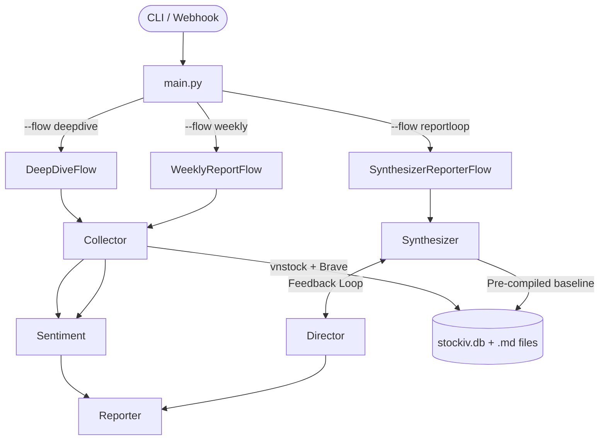

# StockIV

AI-powered stock analysis using [CrewAI](https://www.crewai.com/) agent orchestration, targeting the Vietnamese stock market (HOSE/HNX/UPCOM).

## Setup

1. **Install dependencies:**
   ```bash
   uv sync
   ```

2. **Configure environment variables:**
   ```bash
   cp .env.example .env
   # Edit .env and add your API keys (Anthropic/DashScope, Brave Search, vnstock, Discord, etc.)
   ```

3. **Run:**
   ```bash
   uv run stockiv-run --flow deepdive --ticker FPT
   ```

---

## CLI Commands

```bash
# Deep-dive single ticker analysis (Collector → Sentiment → Synthesizer loop)
uv run stockiv-run --flow deepdive --ticker FPT

# Weekly macro market sentiment report
uv run stockiv-run --flow weekly

# Synthesizer → Director feedback loop with publication
uv run stockiv-run --flow reportloop --ticker MWG --max_loops 3

# Mock specific crews for testing
uv run stockiv-run --flow reportloop --ticker FPT --mock all
uv run stockiv-run --flow reportloop --ticker FPT --mock synthesizer,director

# Run as module
uv run python -m stockiv

# Add dependencies (always use uv, never pip/poetry)
uv add <package>
uv add --dev <package>

# Run pre-commit hooks (linting + secret detection)
uv run pre-commit run --all-files

# Start the FastAPI webhook server (for n8n/Discord integration)
uv run python -m stockiv.api
```

---

## Project Structure

```
stock-agent/
├── src/stockiv/
│   ├── agents/                    # Shared LLM configuration (base.py)
│   ├── crews/                     # Individual CrewAI crews
│   │   ├── collector/             # Data gathering (vnstock, Brave, PDF reports)
│   │   ├── sentiment_analyst/     # Macro & ticker sentiment analysis
│   │   ├── synthesizer/           # GCCP framework evaluation engine
│   │   ├── director/              # Quality control & anomaly detection
│   │   ├── reporter/              # Translation, PDF export, Discord publishing
│   │   └── orchestrator/          # User request classification & routing
│   ├── flows/                     # CrewAI Flow orchestration
│   │   ├── deepdive.py            # Full single-ticker pipeline
│   │   ├── report_loop.py         # Synthesizer⇄Director feedback loop
│   │   └── weekly.py              # Weekly macro sentiment pipeline
│   ├── config/paths.py            # Centralized path management
│   ├── knowledge/                 # GCCP framework strategy docs
│   ├── utils/                     # Logger, freshness checks
│   ├── api.py                     # FastAPI webhook endpoints
│   └── main.py                    # CLI entry point
├── tools/                         # Custom CrewAI @tool implementations
│   ├── vnstock_tools.py           # Vietnamese stock market data tools
│   ├── sqlite_tools.py            # Database query & metric calculation tools
│   ├── brave_tools.py             # Web search tools
│   ├── report_finder_tools.py     # Annual report PDF finder & converter
│   ├── pdf_exporter_tool.py       # Markdown → PDF export
│   ├── discord_publisher_tool.py  # Discord message publishing
│   └── cache_tools.py             # Cache management
├── data/                          # Runtime data (gitignored)
│   ├── raw/                       # API responses, context files, PDFs
│   ├── processed/                 # Sentiment reports, synthesizer output
│   └── reports/                   # Final PDF reports
├── tests/                         # Test scripts
├── scripts/                       # Developer utilities
├── docs/                          # Architecture & reference docs
├── Slave/                         # AI identity & long-term memory
├── memory/                        # Daily progress logs
└── pyproject.toml                 # Dependencies (uv)
```

---

## Architecture Overview



Each crew has its own `README.md` with Mermaid diagrams and task breakdowns. See `src/stockiv/crews/*/README.md`.

---

## LLM Configuration

All LLMs are configured in `src/stockiv/agents/base.py` via DashScope API (Anthropic provider format):

| Instance | Model | Role |
|:---|:---|:---|
| `primary_llm` | qwen3.5-plus | Reporter, Collector Manager |
| `light_llm` | qwen3-coder-plus | Workers (Data Specialist, PDF, Formatter, etc.) |
| `advanced_llm` | qwen3-max-2026-01-23 | Synthesizer Manager, Director, Sentiment Analysts |
| `orchestrator_llm` | qwen2.5-vl-72b-instruct | Router |

---

## Requirements

- Python 3.12+
- API keys: DashScope (Qwen LLMs), Brave Search, vnstock, Discord Bot Token
- See `.env.example` for full list

## Resources

- [CrewAI Documentation](https://docs.crewai.com/)
- [vnstock Documentation](https://docs.vnstock.site/)
- [Architecture Guide](docs/crewai_architecture_guide.md)
- [Crew Architecture](docs/crew_architecture.md)
- [Database Guide](docs/database_guide.md)
