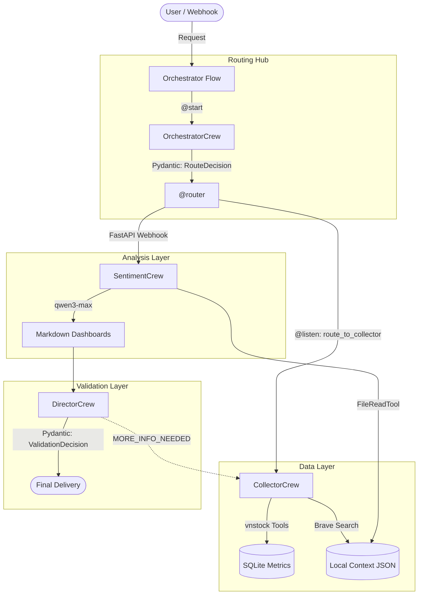

# StockIV Crew Architecture

This document visualizes the skills, attributes, and interactions of the core CrewAI agents in the StockIV ecosystem.

## 1. Orchestrator Crew
**Role:** The Router and Coordinator.
**Mechanism:** Uses an LLM to dynamically parse user intents and trigger appropriate discrete workflows.

*   **Agents:**
    *   **Router:** Determines the execution path based on user requests (e.g., routing to Collector). Uses `primary_llm`.
*   **Tasks:**
    *   `routing_task`: Outputs a precise `RouteDecision` Pydantic model.
*   **Flow Integration (`StockOrchestratorFlow`):**
    *   Receives state input (`request`).
    *   Uses `@router` to determine if data gathering is needed (`route_to_collector`) or if the request is unrecognized.
    *   Uses `@listen` to dynamically spin up downstream crews (like the Collector Crew).

---

## 2. Collector Crew
**Role:** Data Gathering Authority.
**Mechanism:** Fetches raw quantitative pricing, financial statements, and qualitative macro news. Writes data to local SQLite DBs and JSON caches to prep for downstream crews.

*   **Agents:**
    *   **Market Data Fetcher:** Quantitative specialist.
        *   *Tools:* `fetch_historical_prices`, `fetch_financial_statements`, `fetch_financial_ratios`, `fetch_company_overview`, `fetch_ratio_summary`, `fetch_dividend_history` (Powered by `vnstock`).
    *   **Macro Micro Scout:** Qualitative specialist.
        *   *Tools:* `search_market_context` (Powered by Brave Search).
*   **Tasks:**
    *   `fetch_financials_task`
    *   `fetch_daily_market_data_task`
    *   `fetch_macro_context_task`
    *   `fetch_ticker_context_task`

---

## 3. Sentiment Analyst Crew
**Role:** Market Mood & News Interpretation.
**Mechanism:** Reads cached context files from the Collector and generates structured markdown dashboards. Operates on two distinct cadences (Scheduled Weekly vs. On-Demand Symbol).

*   **Agents:**
    *   **Sentiment Analyst:** Specialized analyst using the heavy reasoning `qwen3-max-2026-01-23` model.
        *   *Tools:* `FileReadTool` (to ingest Crawler context).
*   **Tasks:**
    *   `summarize_market`: Weekly macro report generation.
    *   `summarize_symbol`: On-demand specific ticker analysis.
*   **Unique Attributes:**
    *   Initializes with a custom persistent memory vector store utilizing local PyTorch/ONNX `sentence-transformers/all-MiniLM-L6-v2` to prevent HuggingFace API rate limits.

---

## 4. Director Crew
**Role:** Quality Control & Fraud Detection Authority.
**Mechanism:** Acts as the final tollgate for all analysis inside the system. Validates work against the Good Company Cheap Price (GCCP) framework and prevents hallucinations.

*   **Agents:**
    *   **Director:** The stern validator.
*   **Tasks:**
    *   `validate_analysis`: Outputs a strict `ValidationDecision` Pydantic model.
*   **Decisions:**
    *   `[APPROVED]`: Passes quality gate.
    *   `[REJECTED]`: Fails methodological validation.
    *   `[MORE_INFO_NEEDED]`: Kicks analysis back to research crews.

---

## System Interaction Diagram

