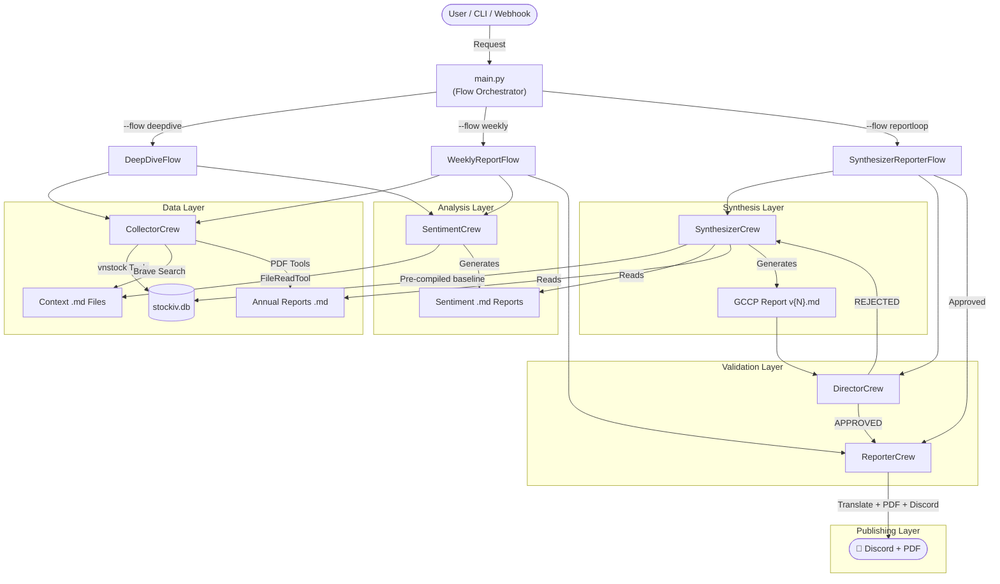

# StockIV Crew Architecture

This document visualizes the skills, attributes, and interactions of all 6 CrewAI crews in the StockIV ecosystem.

## 1. Orchestrator Crew
**Role:** Router and Classifier.
**Process:** Sequential (1 agent, 1 task).

- **Agent:** `router` — Classifies user requests and extracts ticker symbols. Uses `orchestrator_llm` (qwen2.5-vl-72b-instruct).
- **Task:** `routing_task` → Outputs `TickerExtraction` Pydantic model (`is_valid`, `target_ticker`).

---

## 2. Collector Crew
**Role:** Data Gathering Authority.
**Process:** Hierarchical (1 manager + 3 workers).

- **Agents:**
  - **Chief Data Orchestrator** (Manager) — Delegates tasks via `ask_question_to_coworker`. Uses `light_llm`.
  - **Market Data Fetcher** — Quantitative specialist. Tools: `fetch_historical_prices`, `fetch_financial_statements`, `fetch_financial_ratios`, `fetch_company_overview`, `fetch_ratio_summary`, `fetch_dividend_history`, `crawl_vietstock_ratios`, `crawl_vnindex_ratios`.
  - **Macro Micro Scout** — Qualitative specialist. Tools: `search_market_context`, `clean_expired_cache`.
  - **Annual Report Analyst** — PDF retrieval. Tools: `search_annual_report_pdf`, `download_and_convert_pdf`.
- **Tasks:** `fetch_financials_task`, `fetch_annual_report_task`, `fetch_daily_market_data_task`, `crawl_live_ratios_task`, `fetch_macro_context_task`, `fetch_ticker_context_task`.

---

## 3. Sentiment Analyst Crew
**Role:** Market Mood & News Interpretation.
**Process:** Sequential (3 agents).

- **Agents:**
  - **Macro Sentiment Analyst** — Weekly broad macro analysis. Uses `advanced_llm` with reasoning. Tools: `FileReadTool`.
  - **Macro Trend Synthesizer** (`trend_analyst`) — Rolling multi-week trend synthesis. Uses `advanced_llm`. Tools: `DirectoryReadTool`, `FileReadTool`, `FetchMarketIndexTool`.
  - **Ticker Sentiment Specialist** — Ticker-specific sentiment. Uses `advanced_llm`. Tools: `FileReadTool`.
- **Tasks:** `summarize_current_week_macro`, `synthesize_recent_trends`, `summarize_symbol_sentiment`.

---

## 4. Synthesizer Crew
**Role:** Core GCCP Analytical Engine.
**Process:** Sequential with delegation (5 agents).

- **Agents:**
  - **Chief Synthesis Orchestrator** (Manager) — Reads data + sentiment, delegates, compiles report. Uses `advanced_llm` with reasoning. GCCP knowledge injected into backstory.
  - **Quantitative Risk Analyst** — Detects numerical anomalies in financial summary. Uses `advanced_llm`.
  - **Data Specialist** — Python calculations + charts. Uses `light_llm`. Tools: `execute_python_code`, `FileReadTool`, `append_to_file`.
  - **Forensic Accountant** — Semantic search of annual reports. Uses `light_llm`. Tools: `DirectoryReadTool`, `MDXSearchTool`.
  - **Market Researcher** — Supplementary web context. Uses `light_llm`. Tools: `search_market_context`.
- **Pre-compilation:** `@before_kickoff` deterministically assembles `{ticker}_financial_summary.md` from SQLite. No LLM involved.
- **Tasks:** `detect_quantitative_anomalies`, `forensic_annual_report_review`, `compile_evaluation_report`.

---

## 5. Director Crew
**Role:** Quality Control & Fraud Detection Authority.
**Process:** Sequential (1 agent).

- **Agent:** `director` — Validates synthesis reports against ground truth data. Uses `advanced_llm`. Tools: `read_file` (custom wrapper).
- **Task:** `validate_analysis` → Outputs `DirectorDecision` Pydantic model.
- **Decisions:** `[APPROVED]`, `[REJECTED]`, `[MORE_INFO_NEEDED]`.
- **Key Behavior:** Report content and financial summary are pre-read by the flow and injected into the task prompt.

---

## 6. Reporter Crew
**Role:** Final-Mile Publishing Engine.
**Process:** Sequential (4 agents).

- **Agents:**
  - **Translator** — Translates reports to Vietnamese. Uses `primary_llm`. Tools: `FileReadTool`.
  - **PDF Generator** — Converts markdown to PDF. Uses `light_llm`. Tools: `markdown_to_pdf`.
  - **Formatter** — Condenses for Discord (≤1900 chars). Uses `light_llm`.
  - **Discord Publisher** — Publishes to Discord. Uses `light_llm`. Tools: `send_discord_message`.
- **Tasks:** `translate_report`, `export_to_pdf`, `format_report`, `publish_to_discord`.

---

## System Interaction Diagram

---

## LLM Configuration

| LLM Instance | Model | Used By |
|:---|:---|:---|
| `primary_llm` | qwen3.5-plus | Reporter agents, Collector Manager |
| `light_llm` | qwen3-coder-plus | Data Specialist, Forensic Accountant, Market Researcher, PDF/Formatter/Discord agents, Market Data Fetcher |
| `advanced_llm` | qwen3-max-2026-01-23 | Synthesizer Manager, Quantitative Risk Analyst, Director, Sentiment Analysts |
| `orchestrator_llm` | qwen2.5-vl-72b-instruct | Router |

All LLMs configured via `src/stockiv/agents/base.py` using Anthropic provider format through DashScope API.
