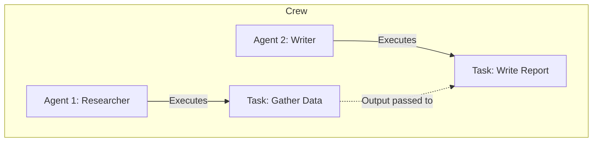
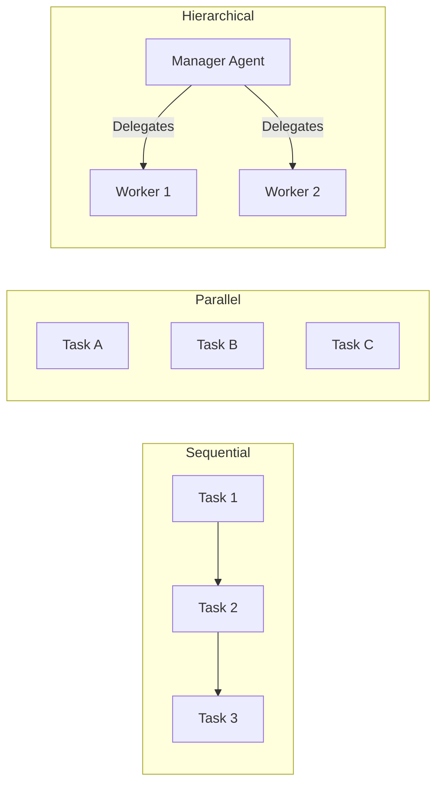
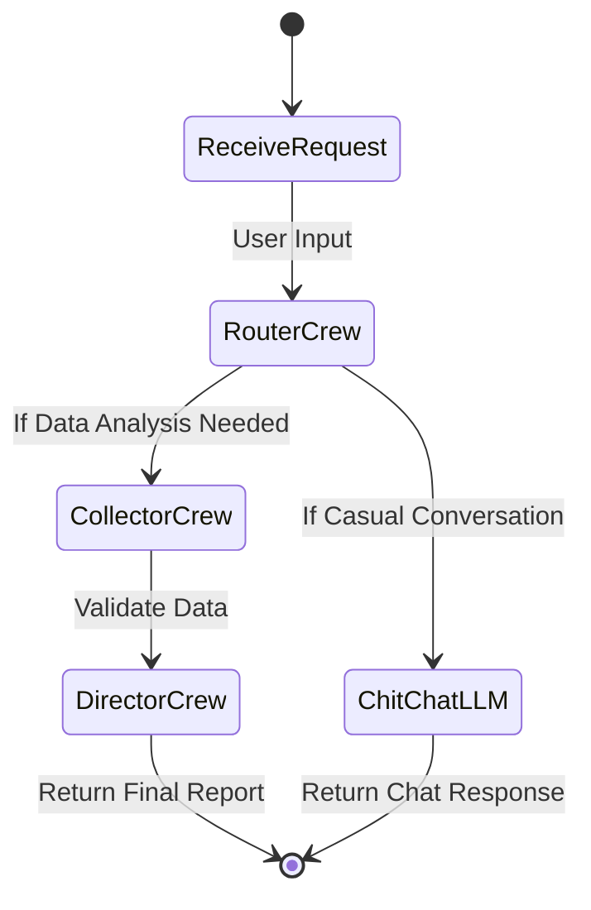

# CrewAI Core Concepts & Architecture Guide

This document summarizes the core concepts of CrewAI, how they interact, and architectural best practices for building production systems.

## 1. The Core Trinity: Agents, Tasks, and Crews

The fundamental building blocks of any CrewAI application.

- **Agent:** Think of an Agent as an employee with a specific role, goal, backstory, and set of tools. They possess agency to make decisions based on their persona.
- **Task:** A specific assignment. It defines what needs to be done (`description`), what the output should look like (`expected_output`), and optionally forces a specific structure (`output_pydantic`).
- **Crew:** A team of Agents working together to accomplish a set of Tasks.



## 2. Processes (How tasks are executed)

When a Crew is kicked off, the `process` defines how the Agents tackle the Tasks.

1.  **Sequential (Default):** Tasks are executed one after another in the order they are defined. The output of Task 1 is appended to the context of Task 2.
2.  **Parallel:** Tasks are executed simultaneously. This is crucial for speed. Tasks can only run in parallel if they don't depend on each other's outputs. (If Task B needs Task A's output, they cannot be parallel).
3.  **Hierarchical:** Instead of a predefined list, a "Manager Agent" (usually powered by a strong LLM) dynamically delegates tasks to other agents based on the overall goal.



## 3. Stateful Orchestration: CrewAI Flows

**Flows** are the modern state-of-the-art way to build AI applications. While a single Crew is great for a specific job, real-world apps usually feature multiple different Crews, user inputs, and conditional logic.

A Flow is a state machine that wraps around your Crews.

- **Why use Flows?** If you have an application that requires routing (e.g., "If user asks for stock data, trigger `CollectorCrew`; if user asks for general chat, trigger `ChatCrew`"), you should use a Flow.
- **State:** Flows maintain shared state across multiple Crews and standalone Python functions, allowing for complex multi-step pipelines.



## 4. Flows vs. Hierarchical Process

While both seem to "manage how work gets done," they operate at completely different levels of your application.

### A. Scope (Team vs. The Whole Company)
*   **Hierarchical Process (Inside a single Crew):** This dictates how a single isolated team works. If `Process.hierarchical` is enabled, an LLM acts as the "Manager" for that specific crew. Standard tasks stop being a linear checklist; instead, the Manager dynamically looks at the goal and assigns sub-tasks to the agents available in that crew.
*   **Flows (Across Multiple Crews):** This is the application layer. A Flow controls the entire lifecycle, connecting *different* crews together, managing user inputs, and executing standard Python functions alongside AI tasks.

### B. Determinism (LLM Magic vs. Python Logic)
*   **Hierarchical Process:** The routing is **100% determined by the LLM** in real-time. The Manager LLM reads the goal, decides who gets what assignment, and evaluates the output.
    *   *Pros:* Highly flexible and autonomous.
    *   *Cons:* Very token-expensive, slower, and unpredictable. It's notoriously hard to test because the LLM might decide to alter its workflow on any given run.
*   **Flows:** The routing is primarily **deterministic Python code** (e.g., `if user_intent == "analyze": return StockCrew().kickoff()`).
    *   *Pros:* Extremely reliable, testable, fast, and structured. You control exactly what happens next.
    *   *Cons:* You have to write the state machine logic yourself.

### C. State Management
*   **Hierarchical Process:** Agents share context organically within the Crew kickoff.
*   **Flows:** Utilize a strict, globally accessible **State** (like Pydantic models). The state explicitly tracks variables across multiple different Crews from the moment the user makes a request to the final output.

**The Executive Summary:**
Use **Hierarchical Process** when you have a messy, creative goal and you want an LLM Manager to dynamically boss around a team to figure it out on the fly.
Use **Flows** when you are building a production software application that needs strict rules, structured API data drops, reliable Pydantic inputs/outputs, and predictable routing between distinct AI microservices.

## 5. Memory Systems

Out of the box, LLMs are stateless. CrewAI provides a sophisticated memory injection system to give agents context across executions.

- **Short-Term Memory:** Runs inside a single execution. It allows agents to remember context relevant to the current task run, acting essentially as a temporary vector database of the current session so they don't hallucinate or repeat mistakes.
- **Entity Memory:** A specialized short-term memory that specifically extracts and remembers facts about "Entities".
- **Long-Term Memory:** Retained across multiple completely different executions. It uses a database (like SQLite + ChromaDB) to save user preferences, past interactions, and lessons learned so the agent gets "smarter" the more you use it.

## 6. Structured Outputs & Integration

In production apps, relying on an AI to return clean markdown text isn't enough; you need code to parse the result.

- **output_pydantic:** By assigning a Pydantic model to a Task, CrewAI under the hood prompts the LLM to output rigid JSON and automatically unpacks it into a strongly-typed Python object. This represents the bridge between natural language and deterministic code execution.

```mermaid
graph LR
    A[Unstructured Output] -->|Task completes| B{output_pydantic}
    B -->|Enforces schema| C[{"ticker": "FPT", "confidence": 0.95}]
    C -->|Used by Python code| D[Database/API]
```

## Summary Table: When to use what

| Feature | When you need it | Example |
| :--- | :--- | :--- |
| **Crew Base** | Standard generation tasks | Scraping the web and writing a blog post. |
| **Process.parallel** | High-latency API tasks | Fetching 5 different stock tickers at the same time. |
| **Process.hierarchical** | Complex, undefined problems | "Research this broad topic and present however fits best." |
| **Flows**| Conditional logic, routing, event-driven | A full application handling user inputs, routing, and multi-crew pipelines. |
| **Memory** | Complex multi-turn tasks & context retention | An agent that needs to remember a user's name across an execution. |
| **output_pydantic** | API integration, systematic routing | Forcing an Orchestrator to decide between `[APPROVED, REJECTED]`. |

---

## 7. Case Study: Stock Analysis (Single Crew vs. Multiple Crews)

For a complex modular use case like analyzing a stock, **it is a best practice to spawn multiple Crews orchestrated by a Flow**, rather than stuffing all agents into a single massive Crew.

### Why Multiple Crews (Orchestrated by a Flow) is Better Here:

1. **Separation of Concerns (Database vs. Analysis):**
   - Gathering financial data requires strict JSON parsing, hitting APIs (vnstock), and saving numbers exactly as-is into SQLite. This requires deterministic, low-temperature behavior.
   - Analyzing that data requires creative, high-temperature reasoning and drafting.
   - Forcing a Data Engineer agent and a Quant Analyst agent into the same Crew pollutes their context window. The Analyst doesn't need to see the raw JSON HTTP payloads of the VNStock API; they just need the final retrieved metrics.

2. **Conditional Execution (Error Handling):**
   - In a single Crew, if the Data Fetcher agent fails to get the VNStock API data, the Analysis agent might still try to run, "hallucinating" numbers to complete its task.
   - With Multiple Crews inside a Flow, you can use Python code to say: `if data_collection_failed: return Error`—preventing the Analysis crew from hallucinating entirely.

3. **Speed (Parallel Execution):**
   - You can have one Crew scraping news (Brave API) and another Crew doing Technical Analysis charts (TA-Lib) simultaneously. A single crew usually dictates a tighter sequential bottleneck.

### When would a Single Crew be enough?

You should use multiple Agents in a **Single Crew** when the tasks are deeply interconnected and require the agents to brainstorm together.

**Example:** If your goal is _simply_ "Write a blog post about FPT stock," you don't need a Flow. A single Crew with a `ResearcherAgent` and a `WriterAgent` is perfect. The Researcher grabs the latest news, instantly hands the markdown notes to the Writer in the same context window, and the Writer outputs the blog.

### Conclusion for StockIV
Because StockIV involves heavy API data gathering, strict step-validation (Director checking Analyst work), and saving to SQLite, **the Multiple Crews + Flow architecture we currently have is the ideal, production-grade state-of-the-art.**
