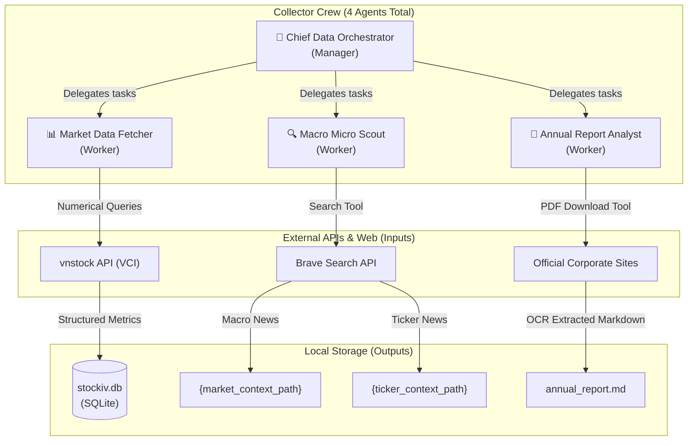

# Collector Crew

The **Collector Crew** is the foundation of the StockIV analytics pipeline. Acting as the "Data Gathering Authority," its primary objective is to autonomously fetch, validate, and store all raw quantitative financial data and qualitative market context required by downstream analytical crews.

## 🏗️ Architecture & Data Flow

The Crew operates on a **Hierarchical Process**. A central Manager Agent receives all tasks and intelligently delegates them to the appropriate specialized subordinate based on their tools and expertise.

---

## 🧑‍🤝‍🧑 The Agents (4 Total)

The crew is composed of exactly **4 agents**: 1 Manager and 3 Specialized Workers.

### 0. Chief Data Orchestrator (Manager)
- **Role:** Safely orchestrate and delegate all data gathering without executing tasks itself.
- **Tools Included:** None directly. Uses `Delegate work to co-worker` to manage the pipeline.

### 1. Quantitative Market Data Specialist (`market_data_fetcher`)
- **Role:** Extracts precise numerical data from stock APIs and populates the local database. Only handles numerical parameters and structured tables.
- **Tools Included:**
  - `fetch_historical_prices`
  - `fetch_financial_statements`
  - `fetch_financial_ratios`
  - `fetch_ratio_summary`
  - `fetch_company_overview`
  - `fetch_dividend_history`
  - `crawl_vietstock_ratios`
  - `crawl_vnindex_ratios`

### 2. Macroeconomic & Market Context Researcher (`macro_micro_scout`)
- **Role:** Hunts down global events, domestic news, and qualitative macro/micro text context. Must clear stale data before querying.
- **Tools Included:**
  - `clean_expired_cache`
  - `search_market_context`

### 3. Corporate Archive Retrieval Specialist (`annual_report_analyst`)
- **Role:** Finds, downloads, and converts physical Annual Report PDFs into readable Markdown formats.
- **Tools Included:**
  - `search_annual_report_pdf`
  - `download_and_convert_pdf`

---

## 📋 Task Breakdown (Input & Output Mapping)

The table below breaks down the 6 main tasks, matching exactly which agent is delegated the work, their inputs, outputs, and the specific tools used. *(Note: The manager assigns all of these initially.)*

| Task Name | Assigned Agent | Input Variables | Expected Output | Tools Principally Used |
|:---|:---|:---|:---|:---|
| **`fetch_financials_task`** | `market_data_fetcher` | `{stock_symbols}` | **Confirmation Message:** Historical financial statements saved directly to SQLite `stockiv.db`. | `fetch_financial_statements`, `fetch_historical_prices`, `fetch_financial_ratios` |
| **`fetch_annual_report_task`** | `annual_report_analyst` | `{stock_symbols}` | **Confirmation Message:** PDF found, downloaded, extracted, and Markdown file path returned (e.g., `data/processed/...`). | `search_annual_report_pdf`, `download_and_convert_pdf` |
| **`fetch_daily_market_data_task`** | `market_data_fetcher` | `{stock_symbols}` | **Confirmation Message:** Live trading values, VNINDEX, metrics (P/E, P/B), and top peers saved to `stockiv.db`. *(Depends on `fetch_financials_task`)* | `fetch_historical_prices`, `fetch_company_overview`, `fetch_ratio_summary` |
| **`crawl_live_ratios_task`** | `market_data_fetcher` | `{stock_symbols}` | **Confirmation Message:** Live ratios (P/E, P/B, EPS, market cap) crawled from Vietstock and VNINDEX benchmark ratios saved to `stockiv.db`. | `crawl_vietstock_ratios`, `crawl_vnindex_ratios` |
| **`fetch_macro_context_task`** | `macro_micro_scout` | None *(Focuses broadly on VN economy / Global trends)* | **Raw Markdown File:** Full un-summarized compilation of text, quotes, and URLs globally & domestically. Saved to `{market_context_path}`. | `clean_expired_cache`, `search_market_context` |
| **`fetch_ticker_context_task`** | `macro_micro_scout` | `{stock_symbols}` *(Also reads context from macro task)* | **Raw Markdown File:** Specific news, management interviews, and events about the exact ticker. Saved to `{ticker_context_path}`. | `search_market_context` |

---

## 💾 Storage & Data Accessibility

**Rule of Thumb for Downstream Crews:** *If the Collector Crew ran successfully, you do NOT need API tools. Read from disk.*

- **Quantitative Analysts / Synthesizer:** Use SQLite database tools to query `data/stockiv.db`.
- **Sentiment Analysts / Reporting:** Use File Read tools to read the markdown outputs in `data/raw/` and `data/processed/`.

---

## ⚠️ Architectural Constraints & Limitations

- **Premium API Restrictions:** Due to free-tier restrictions across Vietnamese data providers (`vnstock`, `VNDirect`, `Fireant`, `SSI`), the Collector Crew does **NOT** actively fetch quantitative, overarching market valuation metrics (e.g., VNINDEX P/E or P/B) or explicit macroeconomic statistics (e.g., Vietnam GDP, CPI, Retail Sales) into the database.
- **Contextual Workaround:** Downstream analytical agents (like the `macro_sentiment_analyst`) are explicitly instructed to deduce macroeconomic trends qualitatively by reading the web-scraped ` market_context.md` files generated by the `macro_micro_scout` rather than querying `stockiv.db` for explicit numbers.
