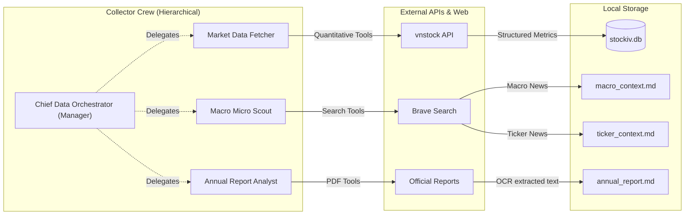
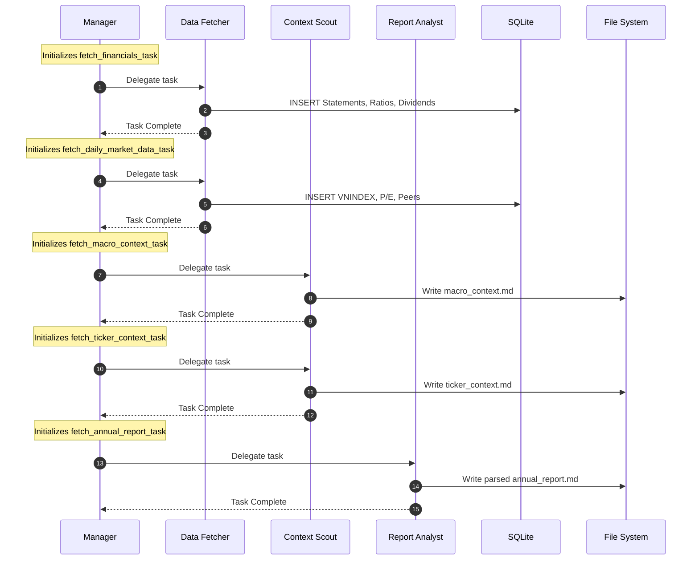

# Collector Crew

The **Collector Crew** is the foundation of the StockIV analytics pipeline. Acting as the "Data Gathering Authority," its primary objective is to autonomously fetch, validate, and store all raw quantitative financial data and qualitative market context required by downstream analytical crews (like the Quant Analyst and Synthesizer).

## Overview Architecture

The Crew operates on a **Hierarchical Process**. A central Manager Agent receives all tasks and delegates them to specialized subordinate agents based on their tools and expertise.

---

## 🧑‍🤝‍🧑 The Agents

### 0. Chief Data Orchestrator (`collector_manager`)
**Role:** Efficiently manage the data collection crew, ensure all necessary information is gathered, and maintain the highest standard of accuracy.
- **Workflow:** Receives all defined tasks. Since it has no direct data gathering tools, it evaluates the task requirements and uses the `Delegate work to co-worker` tool to assign the job to the correct specialist below.

### 1. Quantitative Market Data Specialist (`market_data_fetcher`)
**Role:** Extracts precise numerical data from stock APIs and populates the local database with high accuracy.
- **Tools Included:**
  - `fetch_historical_prices`: Captures OHLCV price history (stocks).
  - `fetch_market_index`: Captures macroeconomic index baselines (VNINDEX).
  - `fetch_financial_statements`: Pulls 10-year quarterly/annual Income, Balance, and Cash Flow assertions.
  - `fetch_financial_ratios`: Pulls historical ROE, ROA, and margin percentages.
  - `fetch_ratio_summary`: Grabs the deep 46-metric summary (P/E, P/B, EV/EBITDA).
  - `fetch_company_overview`: Collects static industry classification and shares outstanding.
  - `fetch_dividend_history`: Scrapes historical dividend payout cash values.

### 2. Macroeconomic & Market Context Researcher (`macro_micro_scout`)
**Role:** Hunts down global events, domestic news, and macroeconomic indicators that impact the target stock or its industry.
- **Tools Included:**
  - `search_market_context`: Autonomously searches the web (e.g., via Brave Search) to read news articles, management interviews, and macroeconomic reports. Uncovers the qualitative narrative behind the numbers.

### 3. Corporate Archive Retrieval Specialist (`annual_report_analyst`)
**Role:** Secure the latest Annual Report (Báo cáo thường niên) PDF for the specified stock and safely convert it into an accessible format.
- **Tools Included:**
  - `search_annual_report_pdf` & `download_and_convert_pdf`: Automates finding and converting physical Annual Report PDFs into readable Markdown.

---

## 📋 Task Execution Pipeline

The Collector Crew executes its tasks using a Hierarchical Process. Tasks are defined *without* hardcoded agents, forcing the Manager to intelligently delegate based on agent capabilities.

### Detailed Task Breakdown

1. **`fetch_financials_task`**
   - **Goal:** Build the historical foundation.
   - **Action:** The Manager delegates to the **Data Fetcher**, who utilizes `vnstock` tools to pull 10-year financial records and ratios, caching them directly into `stockiv.db` to prevent repetitive, expensive API calls down the line.

2. **`fetch_daily_market_data_task`**
   - **Goal:** Capture the "Today" snapshot.
   - **Action:** The Manager delegates to the **Data Fetcher**, who pulls current daily prices for VNINDEX and the target stock. Updates the `ratio_summary` with live valuation metrics (P/E, P/B). It also identifies and retrieves data for top domestic competitors for instant peer comparisons.

3. **`fetch_macro_context_task`**
   - **Goal:** Big picture qualitative research.
   - **Action:** The Manager delegates to the **Context Scout**. The Scout explicitly avoids researching the specific ticker. Instead, it looks at US Fed rates, Vietnam's domestic economy, and broad sector/industry headwinds/tailwinds. Outputs raw, comprehensive narratives to `data/raw/context/`.

4. **`fetch_ticker_context_task`**
   - **Goal:** Narrow qualitative research.
   - **Action:** The Manager delegates to the **Context Scout**. With macro context understood, the Scout searches for specific news events, product launches, or earnings leaks explicitly tied to the target ticker. Results are physically saved to `data/raw/context/`.

5. **`fetch_annual_report_task`**
   - **Goal:** Deep fundamental document retrieval.
   - **Action:** The Manager delegates to the **Archive Retrieval Specialist**, who calculates the most recent fiscal year, hunts the web for the official Vietnamese "Báo cáo thường niên" PDF, downloads it, and utilizes extraction tools to convert the heavy PDF into an LLM-friendly Markdown file stored in `data/processed/annual_reports/`.

---

## 💾 Storage & Data Accessibility

**Rule of Thumb for Downstream Crews:** *If the Collector Crew ran successfully, you do NOT need API tools. Read from disk.*

- **Quantitative Analysts / Synthesizer:** Use the `QueryStockDatabaseTool` and `FetchMarketIndexTool` to execute SQL queries directly against `data/stockiv.db`.
- **Sentiment Analysts / Reporting:** Use the `DirectoryReadTool` or `FileReadTool` to read the context `.md` files residing in `data/raw/` and `data/processed/`.

