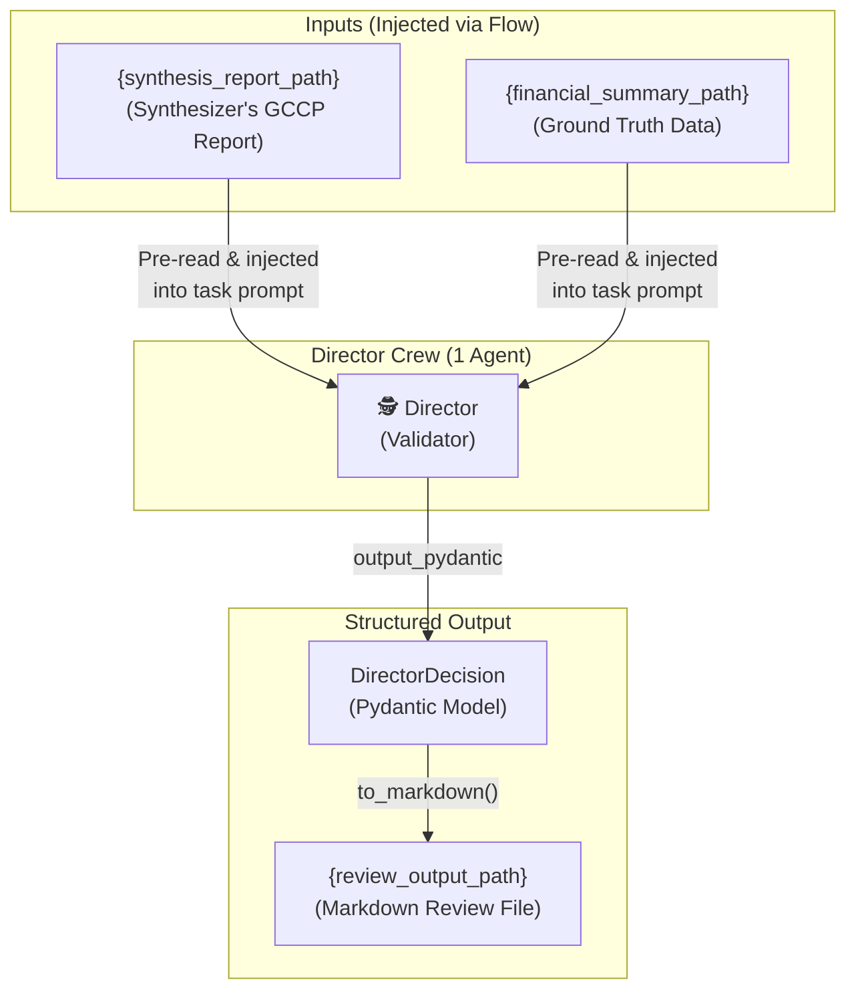

# Director Crew

The **Director Crew** is the quality control and fraud detection authority of the StockIV pipeline. It challenges every analysis with forensic precision — verifying methodology, detecting anomalies, validating evidence, and ensuring only accurate, complete, and well-supported analysis reaches publication.

## 🏗️ Architecture & Data Flow

The Crew operates on a **Sequential Process** with a single agent that makes a structured validation decision.

---

## 🧑‍🤝‍🧑 The Agents (1 Total)

### 1. Director (`director`)
- **Role:** Stern validator who cross-checks the Synthesizer's report against ground truth financial data.
- **LLM:** `advanced_llm` (qwen3-max)
- **Tools:**
  - `read_file` — Custom `@tool` wrapper around file reading (avoids Qwen's `None`-string serialization bug with `FileReadTool`)
- **Key Behavior:** Receives both the synthesis report content and financial summary content directly in the task prompt (pre-read by the flow) to bypass LLM tool-skipping bugs.

---

## 📋 Task Breakdown

| Task Name | Assigned Agent | Input Variables | Expected Output |
|:---|:---|:---|:---|
| **`validate_analysis`** | `director` | `{stock_symbols}`, `{report_content}`, `{financial_summary_content}`, `{synthesis_report_path}`, `{financial_summary_path}` | **Pydantic:** `DirectorDecision` with decision (APPROVED/REJECTED/MORE_INFO_NEEDED), 6 boolean validation checks, anomalies list, failures list, feedback summary, and next steps |

---

## 📊 Structured Output: `DirectorDecision`

A flat Pydantic model with 6 boolean validation checks:

| Check | Description |
|:---|:---|
| `financial_data_verified` | Were 3-5 years of financial statements reviewed? |
| `methodology_sound` | Correct investment style applied? Criteria evaluated? |
| `numbers_accurate` | Calculations verified against Financial Ground Truth? |
| `analysis_complete` | All criteria checked? Risks identified? |
| `logic_and_reasoning_sound` | Conclusions logically consistent with data? |
| `evidence_traceable` | Claims traceable to SQLite DB or annual reports? |

Additional fields: `anomalies` (list of detected financial anomalies), `failures` (consolidated failure list), `feedback_summary`, `next_steps`.

The `to_markdown()` method generates a rich review file consumed by the Synthesizer on revision loops.

---

## ⚠️ Architectural Constraints

- **Content Pre-injection:** The flow pre-reads both the synthesis report and financial summary, injecting their full text into the task prompt. This avoids Qwen models skipping tool calls when `output_pydantic` is set.
- **Ground Truth Validation:** Director MUST compare report claims against the `financial_summary.md` (pre-compiled baseline data from SQLite).
- **No Direct Database Access:** Director reads only files — never queries SQLite directly.
