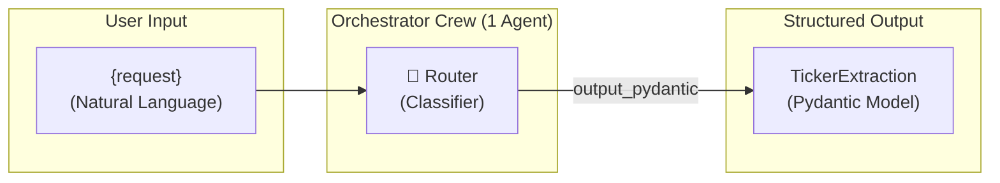

# Orchestrator Crew

The **Orchestrator Crew** is a lightweight routing crew that classifies user requests and extracts target ticker symbols. It acts as the entry gate for the StockIV pipeline, determining whether a request contains a valid stock analysis intent.

## 🏗️ Architecture & Data Flow

The Crew operates on a **Sequential Process** with a single agent and single task.

---

## 🧑‍🤝‍🧑 The Agents (1 Total)

### 1. Router (`router`)
- **Role:** Classifies user requests to determine if they involve stock analysis and extracts the target ticker.
- **LLM:** `orchestrator_llm` (qwen2.5-vl-72b-instruct) — a vision-language model used here for its strong reasoning on classification tasks.
- **Tools:** None — pure LLM classification.

---

## 📋 Task Breakdown

| Task Name | Assigned Agent | Input Variables | Expected Output |
|:---|:---|:---|:---|
| **`routing_task`** | `router` | `{request}` | **Pydantic:** `TickerExtraction` with `is_valid` (bool) and `target_ticker` (string) |

---

## 📊 Structured Output: `TickerExtraction`

| Field | Type | Description |
|:---|:---|:---|
| `is_valid` | `bool` | True if the request is asking to analyze a specific stock/company |
| `target_ticker` | `str` | The extracted ticker symbol (e.g. `"FPT"`, `"AAPL"`). Empty if not found |

---

## ⚠️ Architectural Constraints

- **No Tools:** This is pure LLM classification — no external API calls or file reads.
- **Downstream Routing:** The `TickerExtraction` output is consumed by the parent Flow (e.g., `main.py`) to decide which downstream flow to trigger (DeepDive, Weekly, etc.).
- **Explicit `agent:` in tasks.yaml:** The routing task has an explicit agent assignment since this is a single-agent sequential crew.
