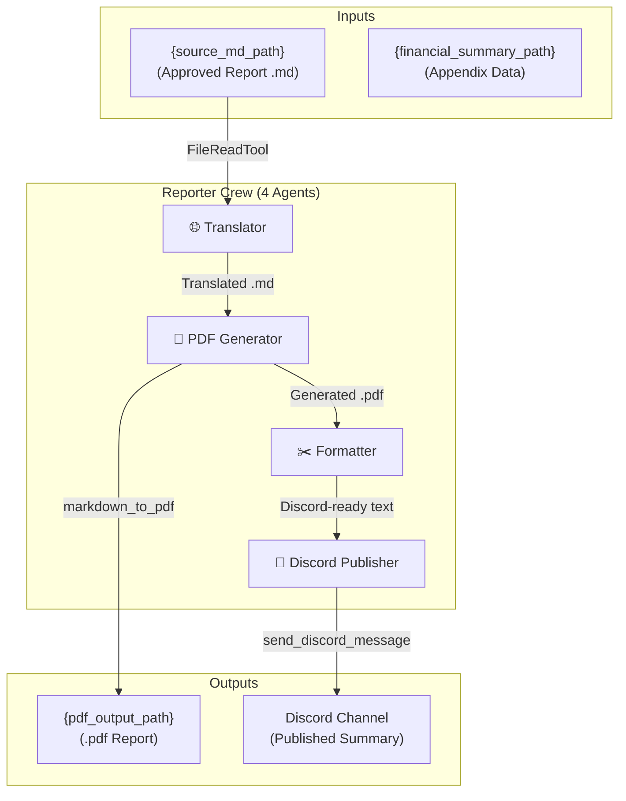

# Reporter Crew

The **Reporter Crew** is the final-mile publishing engine of the StockIV pipeline. It takes an approved synthesis report, translates it to Vietnamese, exports it as a PDF, formats it for Discord, and publishes a summary to a configured Discord channel.

## 🏗️ Architecture & Data Flow

The Crew operates on a **Sequential Process** with 4 agents executing a linear pipeline.

---

## 🧑‍🤝‍🧑 The Agents (4 Total)

### 1. Translator (`translator`)
- **Role:** Reads the source markdown report and translates it to polished Vietnamese.
- **LLM:** `primary_llm`
- **Tools:** `FileReadTool`

### 2. PDF Generator (`pdf_generator`)
- **Role:** Converts the translated markdown into a PDF document.
- **LLM:** `light_llm`
- **Tools:** `markdown_to_pdf` (custom tool using WeasyPrint)

### 3. Formatter (`formatter`)
- **Role:** Condenses the report into Discord-friendly format (respecting 1900-char message limits).
- **LLM:** `light_llm`
- **Tools:** None

### 4. Discord Publisher (`discord_publisher`)
- **Role:** Publishes the formatted summary to a specific Discord channel.
- **LLM:** `light_llm`
- **Tools:** `send_discord_message` (custom tool)

---

## 📋 Task Breakdown (4 Tasks)

| Task Name | Assigned Agent | Input Variables | Expected Output |
|:---|:---|:---|:---|
| **`translate_report`** | `translator` | `{source_md_path}` | Translated Vietnamese markdown report |
| **`export_to_pdf`** | `pdf_generator` | `{pdf_output_path}`, `{report_title}`, `{financial_summary_path}` | PDF file saved to `{pdf_output_path}` |
| **`format_report`** | `formatter` | (receives translated content from context) | Discord-formatted summary text |
| **`publish_to_discord`** | `discord_publisher` | `{discord_channel_id}`, `{stock_symbols}` | Confirmation of Discord message delivery |

---

## ⚠️ Architectural Constraints

- **`discord_channel_id` required:** Each parent flow must explicitly set the Discord channel ID. The crew raises `ValueError` if missing.
- **Auto-generated paths:** If `pdf_output_path` or `report_title` are not provided, they are auto-derived from `source_md_path`.
- **Discord message limits:** Messages must be chunked to ≤1900 characters per message due to Discord API constraints.
