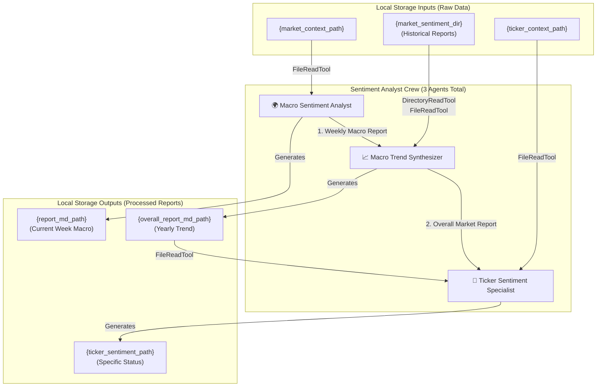

# Sentiment Analyst Crew

The **Sentiment Analyst Crew** acts as the narrative and psychological interpreter for the StockIV pipeline. Its primary objective is to read the raw qualitative context data gathered by the Collector Crew, analyze macroeconomic and ticker-specific news, and generate structured, highly-actionable sentiment reports.

## 🏗️ Architecture & Data Flow

The Crew operates on a **Sequential Process**. It starts broad (global and domestic macro trends), synthesizes historical momentum, and finally narrows down to the specific impact on the target stock ticker.

---

## 🧑‍🤝‍🧑 The Agents (3 Total)

The crew is composed of exactly **3 agents**, executed sequentially to form a top-down analytical funnel.

### 1. Macro Sentiment Analyst (`macro_sentiment_analyst`)
- **Role:** Analyzes broad macroeconomic context to gauge immediate market psychology and emotional trends for the current week.
- **Tools Included:**
  - `FileReadTool`

### 2. Macro Trend Synthesizer (`trend_analyst`)
- **Role:** Analyzes rolling market sentiment by comparing the current week's sentiment against previous weeks' sentiment reports to extract broader momentum.
- **Tools Included:**
  - `DirectoryReadTool`
  - `FileReadTool`

### 3. Ticker Sentiment Specialist (`ticker_sentiment_analyst`)
- **Role:** Gauges the precise sentiment for specific stock symbols by combining the overall market trend with localized ticker news, events, and management actions.
- **Tools Included:**
  - `FileReadTool`

---

## 📋 Task Breakdown (Input & Output Mapping)

The table below breaks down the 3 main tasks, matching exactly which agent executes the work, their inputs, expected outputs, and the specific tools used. *(Note: Execution is strictly Sequential).*

| Task Name | Assigned Agent | Input Variables | Expected Output | Tools Principally Used |
|:---|:---|:---|:---|:---|
| **`summarize_current_week_macro`** | `macro_sentiment_analyst` | `{market_context_path}` | **Markdown Document:** Executive summary, key macro indicators, and structural shifts for the *current week*. Saved to `{report_md_path}`. | `FileReadTool` |
| **`synthesize_recent_trends`** | `trend_analyst` | `{year}`, `{overall_report_md_path}` *(Scans `{market_sentiment_dir}`)* | **Markdown Document:** Big-picture regime shift analysis, forward scenarios, and strategic allocation. Saved to `{overall_report_md_path}`. | `DirectoryReadTool`, `FileReadTool` |
| **`summarize_symbol_sentiment`** | `ticker_sentiment_analyst` | `{stock_symbols}`, `{ticker_context_path}`, `{overall_report_md_path}` | **Markdown Document:** Specific macro resilience summary, scenario stress testing, and invalidation triggers strictly for the given asset. Saved to `{ticker_sentiment_path}`. | `FileReadTool` |

---

## 💾 Storage & Data Accessibility

**Operational Rule:** *The Sentiment Crew does NOT use external APIs. All data must already be collected and formatted on the disk by the Collector Crew before this crew is launched.*

- **Inputs (Read):** Uses CrewAI text tools to read `.md` files residing in `data/raw/` and historical context mapped to `{market_sentiment_dir}`.
- **Outputs (Write):** Generates heavily-formatted `.md` sentiment reports, mapped to explicit output paths by the orchestrator. These documents are subsequently read by downstream orchestrators (like the Synthesizer Crew) to fuse with quantitative assertions.
