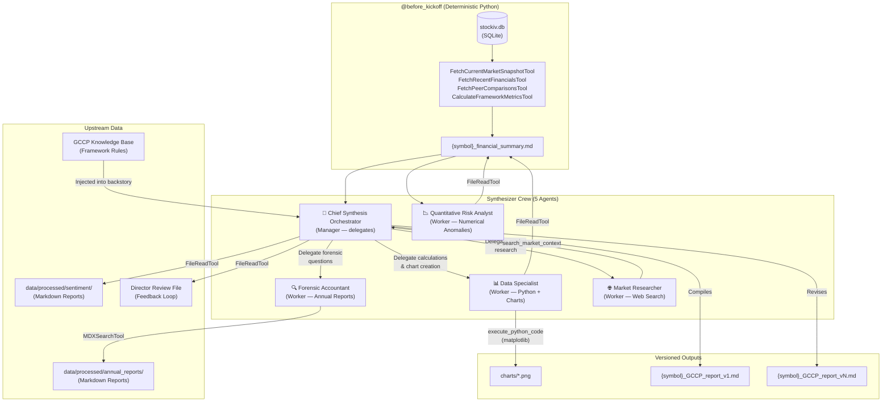
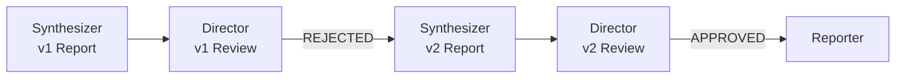

# Synthesizer Crew

The **Synthesizer Crew** is the core analytical engine of the StockIV pipeline. It interprets and evaluates all collected data directly against the **Good Company Cheap Price (GCCP)** investment framework, producing a comprehensive structured evaluation report for the Director to review.

## 🏗️ Architecture & Data Flow

The Crew operates with **`Process.sequential`** — tasks execute in order, but the Manager retains delegation rights to subordinate agents via CrewAI's `ask_question_to_coworker`.

Baseline financial data (Income Statement, Balance Sheet, Cash Flow, Key Ratios, Market Snapshot, Peer Comparisons) is **pre-compiled deterministically** via the `@before_kickoff` hook — no LLM involved.



---

## 🧑‍🤝‍🧑 The Agents (5 Total)

### 1. Chief Synthesis Orchestrator (`synthesizer_manager`)
- **Role:** Manager — reads pre-compiled data & sentiment, delegates calculations/charts/forensic work, compiles final GCCP report
- **LLM:** `advanced_llm` (reasoning enabled, max 3 attempts)
- **Tools:** `FileReadTool`
- **Key Constraint:** 🚫 STRICTLY FORBIDDEN from reading annual reports (prevents hallucination). Delegates to `forensic_accountant`
- **Key Constraint:** Does NOT make final PASS/FAIL decisions (Director's job)
- **Key Constraint:** Must delegate ALL arithmetic to Data Specialist (LLMs unreliable at math)

### 2. Quantitative Risk Analyst (`quantitative_risk_analyst`)
- **Role:** Hunts for numerical anomalies in the pre-compiled financial summary (Earnings Quality, Working Capital bloat, margin trends)
- **LLM:** `advanced_llm` (reasoning enabled)
- **Tools:** `FileReadTool`
- **Key Constraint:** Only reads from `{financial_summary_path}` — no annual reports, no web searches

### 3. Data Specialist (`data_specialist`)
- **Role:** Calculates derived metrics via Python, generates matplotlib charts, reads pre-compiled files
- **LLM:** `light_llm`
- **Tools:** `execute_python_code`, `FileReadTool`, `append_to_file`
- **Key Constraint:** No database access. All data comes from pre-compiled `{financial_summary_path}`

### 4. Forensic Accountant (`forensic_accountant`)
- **Role:** Reads annual report Markdown files for forensic evidence via semantic search (Auditor Trust, Off-Balance-Sheet items)
- **LLM:** `light_llm`
- **Tools:** `DirectoryReadTool` (annual reports), `MDXSearchTool`
- **Unavailability Protocol:** Reports `ANNUAL_REPORT_NOT_AVAILABLE` if no report found

### 5. Market Researcher (`market_researcher`)
- **Role:** Performs targeted web searches for market context when the manager needs supplementary data
- **LLM:** `light_llm`
- **Tools:** `search_market_context`

---

## 📋 Task Breakdown (3 Tasks + Pre-compilation)

| Phase | Task | Assigned To | Description |
|:---|:---|:---|:---|
| Pre-compile | `@before_kickoff` | Python (no LLM) | Deterministically fetches baseline data from SQLite → writes `{financial_summary_path}` |
| Task 1 | `detect_quantitative_anomalies` | `quantitative_risk_analyst` | Read financial summary and flag numerical red flags (earnings quality, margin shifts, working capital anomalies) |
| Task 2 | `forensic_annual_report_review` | `forensic_accountant` | Check annual report availability, run 4 standard forensic checks |
| Task 3 | `compile_evaluation_report` | `synthesizer_manager` | Read baseline + sentiment + anomalies + forensic findings, delegate calculations/charts, compile structured GCCP report |

---

## 🔄 Versioned Feedback Loop

The Synthesizer integrates with the **Director Crew** via `report_loop.py` in a file-based feedback loop:



**File structure per loop:**
```
data/processed/synthesizer/{ticker}/
├── {ticker}_financial_summary.md          # Baseline (pre-compiled once)
├── {ticker}_GCCP_report_v1.md             # Synthesizer V1
├── {ticker}_director_review_v1.md         # Director review of V1
├── {ticker}_GCCP_report_v2.md             # Synthesizer V2 (revised)
├── {ticker}_director_review_v2.md         # Director review of V2
└── charts/                                # Dynamic charts
    ├── {ticker}_revenue_chart.png
    └── ...
```

---

## 📊 Structured Output

### `SynthesizerReport` (Pydantic)
- `is_good` — Overall good company?
- `valuation_is_cheap` — Overall cheap price?
- `actionable_suggestion` — BUY / WAIT / AVOID
- `calculated_target_price` — Target price with Margin of Safety
- `report_markdown` — Full GCCP report as markdown string

---

## ⚠️ Architectural Constraints

- **Pre-compilation:** Baseline data assembled by deterministic Python, never by LLMs
- **Anti-Hallucination:** Manager CANNOT read annual reports — delegates to forensic accountant
- **Math Delegation:** Manager MUST delegate all arithmetic to Data Specialist's `execute_python_code`
- **GCCP Knowledge Injection:** Full framework injected into manager's backstory at runtime
- **No DB on Agents:** All SQLite tools removed from agent toolsets — data only via pre-compiled files
- **Forensic Accountant Isolation:** Restricted to `data/processed/annual_reports/` only
- **Explicit `agent:` in tasks.yaml:** Tasks have explicit agent assignments (sequential process)
