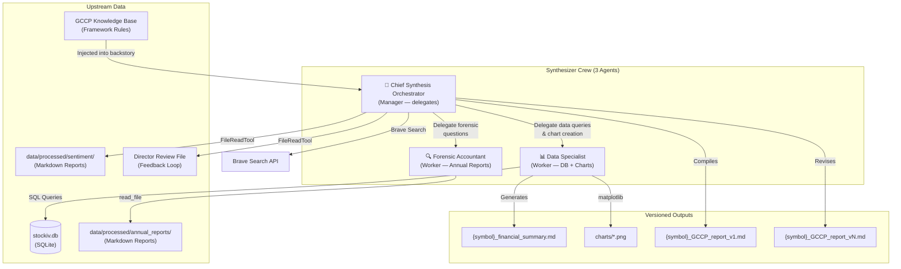
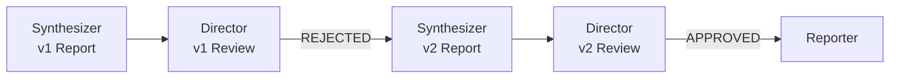

# Synthesizer Crew

The **Synthesizer Crew** is the core analytical engine of the StockIV pipeline. It interprets and evaluates all collected data directly against the **Good Company Cheap Price (GCCP)** investment framework, producing a comprehensive structured evaluation report for the Director to review.

## 🏗️ Architecture & Data Flow

The Crew operates with **`Process.hierarchical`** — a manager agent delegates work to subordinate workers using CrewAI's native delegation.



---

## 🧑‍🤝‍🧑 The Agents (3 Total)

### 1. Chief Synthesis Orchestrator (`synthesizer_manager`)
- **Role:** Manager — delegates work, reads sentiment, compiles final GCCP report
- **LLM:** `advanced_llm`
- **Tools:** `FileReadTool`, `DirectoryReadTool` (sentiment), `search_market_context`
- **Key Constraint:** 🚫 STRICTLY FORBIDDEN from reading annual reports (prevents hallucination). Delegates annual report analysis to `forensic_accountant`
- **Key Constraint:** Does NOT make final PASS/FAIL decisions (Director's job)

### 2. Data Specialist (`data_specialist`)
- **Role:** Extracts financial metrics from SQLite + generates charts via Python
- **LLM:** `light_llm`
- **Tools:** `QueryStockDatabaseTool`, `FetchRecentFinancialsTool`, `FetchPeerComparisonsTool`, `execute_python_code`

### 3. Forensic Accountant (`forensic_accountant`)
- **Role:** Reads annual report Markdown files for forensic evidence
- **LLM:** `light_llm`
- **Tools:** `DirectoryReadTool` (annual reports), `read_file`
- **Unavailability Protocol:** Reports `ANNUAL_REPORT_NOT_AVAILABLE` if no report found

---

## 📋 Task Breakdown (3 Tasks)

| Task | Assigned To | Description |
|:---|:---|:---|
| `collect_baseline_metrics` | `data_specialist` | Extract 3-4 years of financials + peer comparisons, save to `{financial_summary_path}` |
| `forensic_annual_report_review` | `forensic_accountant` | Check annual report availability, run 4 standard forensic checks |
| `compile_evaluation_report` | `synthesizer_manager` | Synthesize all inputs into structured GCCP report with dynamic chart delegation |

---

## 🔄 Versioned Feedback Loop

The Synthesizer integrates with the **Director Crew** via `report_loop.py` in a file-based feedback loop:



**File structure per loop:**
```
data/processed/synthesizer/{ticker}/
├── {ticker}_financial_summary.md          # Baseline (once)
├── {ticker}_GCCP_report_v1.md             # Synthesizer V1
├── {ticker}_director_review_v1.md         # Director review of V1
├── {ticker}_GCCP_report_v2.md             # Synthesizer V2 (revised)
├── {ticker}_director_review_v2.md         # Director review of V2
└── charts/                                # Dynamic charts
    ├── {ticker}_revenue_chart.png
    └── ...
```

---

## 📊 Structured Outputs (Pydantic Models)

### `BaselineMetrics`
- `current_price_data`, `current_vnindex`, `fundamental_ratios`, `multi_year_comparisons`, `peer_competitors`

### `SynthesizerReport`
- 20+ fields covering all GCCP pillars with `to_markdown()` for human-readable export

---

## ⚠️ Architectural Constraints

- **Anti-Hallucination:** Manager CANNOT read annual reports — delegates to forensic accountant
- **GCCP Knowledge Injection:** Full framework injected into manager's backstory at runtime
- **Hierarchical Delegation Bug Guard:** No `agent:` field in `tasks.yaml` (forces manager to use delegation tools)
- **Forensic Accountant Isolation:** Restricted to `data/processed/annual_reports/` only
- **Manual Pydantic Parsing:** JSON extracted via regex due to CrewAI/Anthropic `tool_choice` bug
