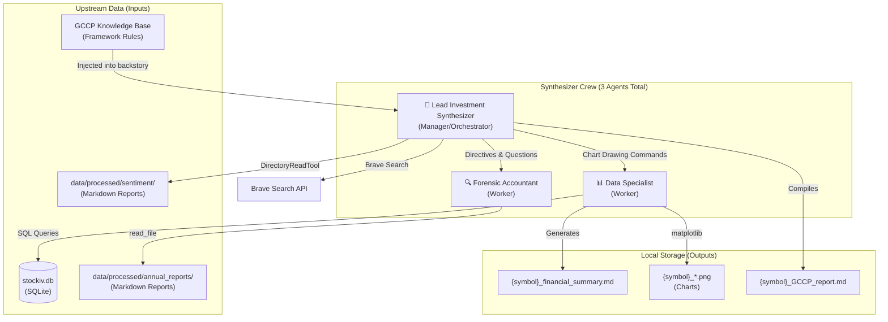
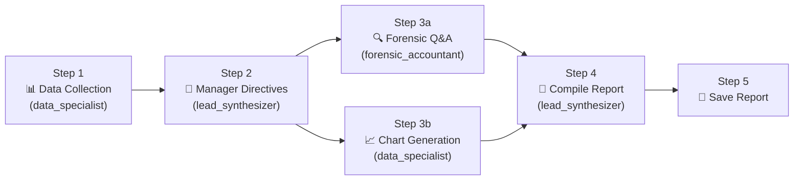

# Synthesizer Crew

The **Synthesizer Crew** is the core analytical engine of the StockIV pipeline. It interprets and evaluates all collected data directly against the **Good Company Cheap Price (GCCP)** investment framework, producing a comprehensive structured evaluation report for the Director to review.

## 🏗️ Architecture & Data Flow

The Crew operates on a **Sequential Process** orchestrated by a `SynthesizerFlow`. The flow runs agents in a structured 5-step pipeline, where later steps depend on outputs of earlier ones. Steps 3a and 3b run in **parallel** (using `and_`), converging before the final compilation.

---

## 🔄 Flow Pipeline (`SynthesizerFlow`)

The `SynthesizerFlow` decomposes the crew into isolated, sequenced micro-crews for reliability:

| Step | Method | Agent | Description |
|:---|:---|:---|:---|
| **1** | `collect_data_step` | `data_specialist` | Extracts baseline financial metrics from SQLite, saves to `{symbol}_financial_summary.md` |
| **2** | `manager_directives_step` | `lead_synthesizer` | Reads baseline + sentiment, generates forensic questions and chart commands |
| **3a** | `accountant_qa_step` | `forensic_accountant` | Answers Manager's questions using annual report documents |
| **3b** | `visualizer_charts_step` | `data_specialist` | Generates matplotlib charts per Manager's directives |
| **4** | `compile_report_step` | `lead_synthesizer` | Cross-references all inputs to compile the final GCCP report |
| **5** | `save_report` | *(none)* | Converts `SynthesizerReport` to Markdown and saves to disk |

---

## 🧑‍🤝‍🧑 The Agents (3 Total)

### 1. Lead Investment Synthesizer (`lead_synthesizer`)
- **Role:** Orchestrates the GCCP report generation. Analyzes baseline data, generates directives for subordinates, and compiles the final structured evaluation.
- **LLM:** `advanced_llm`
- **Key Constraint:** Synthesizer only — does NOT make final PASS/FAIL decisions (that's the Director's job).
- **Tools Included:**
  - `FileReadTool` (general file reading)
  - `DirectoryReadTool` (scoped to `data/processed/sentiment`)
  - `search_market_context` (Brave Search for web clarifications)

### 2. Data Specialist (`data_specialist`)
- **Role:** Dual-purpose agent. **Phase 1:** Extracts raw financial metrics from SQLite. **Phase 2:** Generates charts via Python code execution.
- **LLM:** `light_llm`
- **Tools Included:**
  - `QueryStockDatabaseTool`
  - `FetchRecentFinancialsTool`
  - `FetchPeerComparisonsTool`
  - `execute_python_code` (runs pandas/matplotlib scripts via `uv run python`)

### 3. Forensic Accountant (`forensic_accountant`)
- **Role:** Reads annual report Markdown files to answer specific forensic questions from the Manager. Checks for fake revenue, margin squeeze, hidden debt, and inventory bloat.
- **LLM:** `light_llm`
- **Constraint:** Strictly reads from `data/processed/annual_reports/` only — forbidden from sentiment directory.
- **Tools Included:**
  - `DirectoryReadTool` (scoped to `data/processed/annual_reports`)
  - `read_file` (custom file reader)

---

## 📋 Task Breakdown (Input & Output Mapping)

| Task Name | Assigned Agent | Input Variables | Expected Output | Tools Principally Used |
|:---|:---|:---|:---|:---|
| **`data_specialist_collect_metrics`** | `data_specialist` | `{stock_symbols}`, `{date}` | **`BaselineMetrics` Pydantic model:** Current price, VNINDEX, fundamental ratios, multi-year comparisons, peer competitors. | `FetchRecentFinancialsTool`, `FetchPeerComparisonsTool` |
| **`manager_plan_directives`** | `lead_synthesizer` | `{stock_symbols}`, `{financial_summary}`, `{financial_summary_path}` | **Structured Markdown:** 3 forensic questions for Accountant + 2 chart drawing commands for Visualizer. | `FileReadTool`, `DirectoryReadTool` |
| **`accountant_answer_questions`** | `forensic_accountant` | `{stock_symbols}`, `{manager_directives}`, `{annual_reports_dir}` | **Q&A Response:** Status (MENTIONED/NOT_MENTIONED), Exact Quotes, and Summary per question. | `DirectoryReadTool`, `read_file` |
| **`visualizer_create_charts`** | `data_specialist` | `{stock_symbols}`, `{manager_directives}`, `{synthesizer_output_dir}` | **Markdown image embeds:** `` for each generated chart. | `QueryStockDatabaseTool`, `execute_python_code` |
| **`compile_evaluation_report`** | `lead_synthesizer` | `{stock_symbols}`, `{date}`, `{financial_summary}`, `{accountant_findings}`, `{chart_links}`, `{sentiment_dir}` | **`SynthesizerReport` Pydantic model:** Full GCCP evaluation report as structured JSON. | `FileReadTool`, `DirectoryReadTool`, `search_market_context` |

---

## 📊 Structured Outputs (Pydantic Models)

### `BaselineMetrics`
Raw data extraction output from Step 1. Contains:
- `current_price_data` — Trading price, date, 1-year momentum
- `current_vnindex` — VNINDEX value and momentum
- `fundamental_ratios` — P/E, P/B, ROE, etc.
- `multi_year_comparisons` — Financials across quarters/years with YoY growth
- `peer_competitors` — Target vs. domestic competitors

### `SynthesizerReport`
The final 20+ field structured evaluation covering all GCCP pillars:
- **Quantitative Summary** — Metrics tables, anomaly flags
- **Good Company (Qualitative)** — Business model (Input/Output/Engine), Management & Governance
- **Good Company (Quantitative)** — Capital structure, profitability, cash generation, forensic anomalies
- **Cheap Price** — Market phase, Graham/Lynch criteria, peer comparison, relative valuation, margin of safety
- **Final Synthesis** — BLUF summary, actionable suggestion (BUY/WAIT/AVOID), calculated target price, critical warnings, embedded visuals, citations

Both models include a `to_markdown()` method for human-readable Markdown export.

---

## 💾 Storage & Data Accessibility

**All outputs are saved to:** `data/processed/synthesizer/{stock_symbols}/`

| Output File | Description |
|:---|:---|
| `{symbol}_financial_summary.md` | Baseline metrics from Step 1 |
| `{symbol}_*.png` | Generated charts (revenue, margins, etc.) |
| `{symbol}_GCCP_report.md` | Final structured GCCP evaluation report |

**Rule of Thumb for Downstream Crews:** The Synthesizer report is consumed by the **Director Crew** for final PASS/FAIL investment decisions.

---

## ⚠️ Architectural Constraints & Limitations

- **Not a Decision Maker:** The Synthesizer explicitly does NOT produce a final PASS/FAIL verdict. That responsibility belongs to the Director Crew downstream.
- **GCCP Knowledge Injection:** The entire GCCP framework text is injected into the `lead_synthesizer`'s backstory at runtime via `kb.framework`, `kb.criteria`, `kb.industry_guides`, etc.
- **Parallel Execution:** Steps 3a (Forensic Q&A) and 3b (Chart Generation) run in parallel using CrewAI's `and_()` combinator, converging at Step 4.
- **Manual Pydantic Parsing:** Due to CrewAI/Anthropic compatibility issues, JSON output is manually extracted via regex and validated against Pydantic models rather than using CrewAI's native `output_pydantic`.
- **Forensic Accountant Isolation:** The forensic accountant is strictly restricted to `data/processed/annual_reports/` to prevent hallucination from reading sentiment files.
