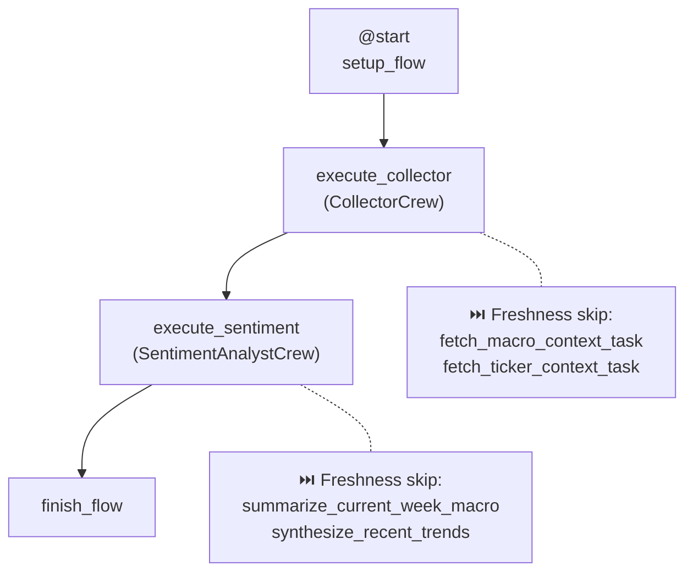

# DeepDive Flow

Full comprehensive GCCP deep-dive analysis for a specific ticker.

## Flow Steps



## State: `PipelineState`

Requires `target_ticker` to be set before kickoff.

## Steps

### 1. `setup_flow` (@start)
Generates all centralized paths in `shared_data`: collector paths, sentiment paths, synthesizer paths, reporter paths. Auto-resolves company name from vnstock listing.

### 2. `execute_collector`
Runs **CollectorCrew** (full: macro + ticker + annual reports). Skips web-search tasks whose output files are still fresh (<7 days via `is_file_fresh()`).

### 3. `execute_sentiment`
Runs **SentimentAnalystCrew** (full: macro + ticker). Skips macro sentiment tasks whose output files are still fresh (<7 days).

### 4. `finish_flow`
Logs completion. Returns execution history.

> **Note:** The synthesizer loop and reporter steps are currently commented out — the `report_loop` mini-flow handles them independently.

## Usage

```bash
uv run stockiv-run --flow deepdive --ticker FPT
```

```python
from stockiv.flows.deepdive import DeepDiveFlow

flow = DeepDiveFlow()
flow.state.target_ticker = "FPT"
result = flow.kickoff()
```
