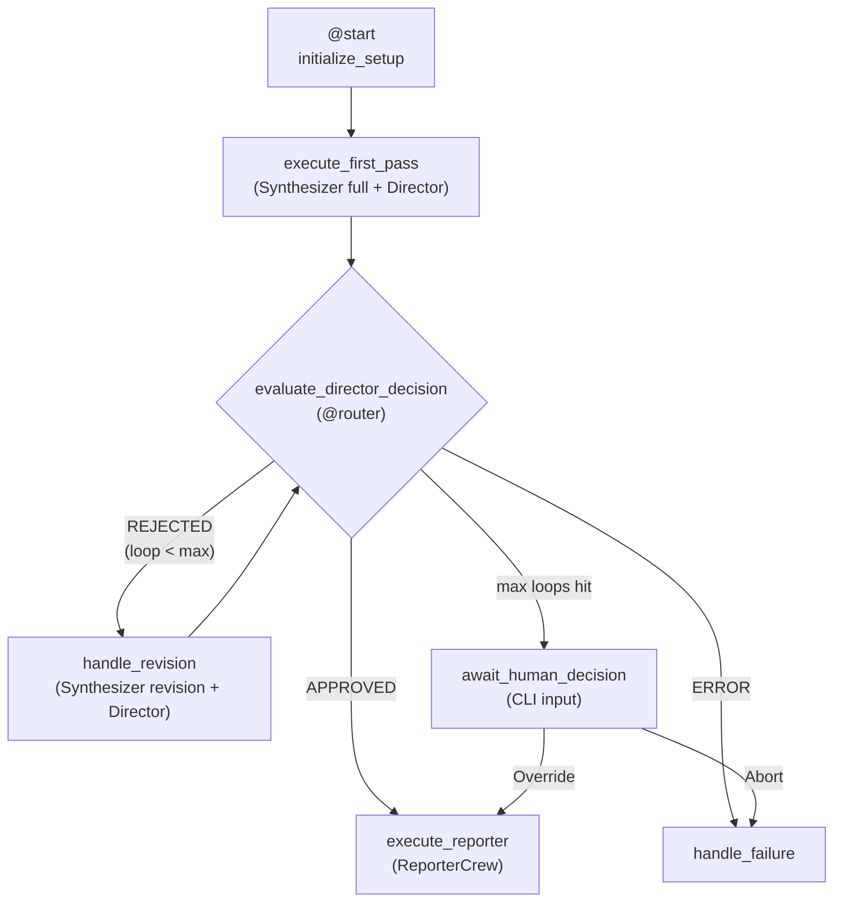

# Report Loop Flow (SynthesizerReporterFlow)

Versioned file-based feedback loop between the Synthesizer and Director crews, with final hand-off to the Reporter crew.

## Flow Steps



## State: `ReportLoopState` (extends PipelineState)

| Field | Default | Description |
|:---|:---|:---|
| `director_feedback_path` | `""` | Path to Director's review file |
| `director_approval` | `"REJECTED"` | APPROVED / REJECTED / MORE_INFO_NEEDED / ERROR |
| `loop_count` | `0` | Current loop iteration |
| `max_loops` | `5` | Maximum allowed retries |
| `report_version` | `1` | Auto-incremented on each revision |
| `discord_channel_id` | (hardcoded) | Target Discord channel for publishing |

## Steps

### 1. `initialize_setup` (@start)
Populates `shared_data` paths from centralized `stockiv.config.paths`. Uses `setdefault` so parent flows can pre-populate without overwrite.

### 2. `execute_first_pass`
Runs Synthesizer (full 3-task pipeline: detect anomalies → forensic review → compile report) then Director review. Writes versioned files: `{ticker}_GCCP_report_v1.md` and `{ticker}_director_review_v1.md`.

### 3. `evaluate_director_decision` (@router)
Routes based on Director's decision and loop count. Returns `"route_to_reporter"`, `"loop_back"`, `"route_to_human_in_loop"`, or `"route_to_failure"`.

### 4. `handle_revision` (@listen "loop_back")
Increments version, runs Synthesizer **revision crew** (evaluate_feedback task only), then Director review.

### 5. `execute_reporter` (@listen "route_to_reporter")
Runs ReporterCrew to translate, generate PDF, and publish to Discord.

### 6. `await_human_decision`
CLI prompt for human override when max loops are exhausted.

## Mock Support

Set `state.mock = ["synthesizer", "director", "reporter", "human"]` to mock specific crews for testing.

## Versioned File Output

```
data/processed/synthesizer/{ticker}/
├── {ticker}_financial_summary.md        # Baseline (pre-compiled once)
├── {ticker}_GCCP_report_v1.md           # Synthesizer V1
├── {ticker}_director_review_v1.md       # Director review of V1
├── {ticker}_GCCP_report_v2.md           # Synthesizer V2 (revised)
└── {ticker}_director_review_v2.md       # Director review of V2
```

## Usage

```bash
uv run stockiv-run --flow reportloop --ticker FPT --max_loops 3
# With mocking:
uv run stockiv-run --flow reportloop --ticker FPT --mock all
```
