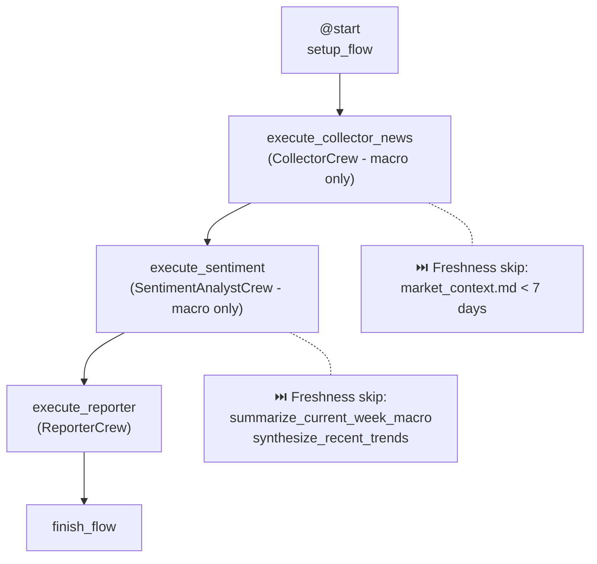

# Weekly Report Flow

Runs a subset of the pipeline focused on macro market sentiment — no ticker-specific analysis.

## Flow Steps



## State: `PipelineState`

No `target_ticker` required (market-wide analysis).

## Steps

### 1. `setup_flow` (@start)
Populates paths for macro context, sentiment output, and report PDF.

### 2. `execute_collector_news`
Runs **CollectorCrew** restricted to `fetch_macro_context_task` only. Skips if `market_context.md` is fresh (<7 days).

### 3. `execute_sentiment`
Runs **SentimentAnalystCrew** restricted to macro tasks only (`summarize_current_week_macro`, `synthesize_recent_trends`). Skips tasks whose output is fresh.

### 4. `execute_reporter`
Runs **ReporterCrew** to translate, export PDF, and publish the weekly macro sentiment to Discord.

### 5. `finish_flow`
Logs completion. Returns execution history.

## Output

Weekly macro sentiment report published to Discord and saved as PDF to `data/reports/market/`.

## Usage

```bash
uv run stockiv-run --flow weekly
```
